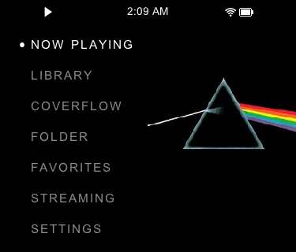
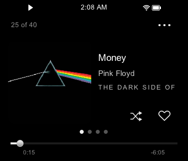

<h1 align="center">Q2 Pod</h1>

  
  &nbsp;
  

  
  
  
  
  
  

<h2>Features</h2>

<table>
  <tr valign="top">
    <td width="200"><b>Interface</b></td>
    <td>Home in a Split, Full or Carousel layout. Menus, Now Playing (regular or Centred), Cover Flow you can swipe, four visualizers and Games. Quick Settings with a swipe down from the top of the screen.</td>
  </tr>
  <tr valign="top">
    <td><b>Display</b></td>
    <td>Minimal, Modern and Classic themes, accent colours, Light Mode with an Auto schedule, Rounded Corners, Night Shift for the evening, and Smart Awake.</td>
  </tr>
  <tr valign="top">
    <td><b>Wheel</b></td>
    <td>Smooth scrolling that speeds up as you spin, with adjustable sensitivity. Menus remember your place. Hold Return for Now Playing or Home, and Single Press Scrub.</td>
  </tr>
  <tr valign="top">
    <td><b>Library</b></td>
    <td>Search, Era (albums by decade), Most Played, Long Songs and favourites. Playlists with Edit Playlist and M3U import and export. Play Next, Add to Queue and View Queue. An empty <code>database.ignore</code> file <a href="#library">hides a folder</a>.</td>
  </tr>
  <tr valign="top">
    <td><b>Ratings</b></td>
    <td>Rate songs and albums from 0 to 5 hearts, then browse Top Rated, Loved and rated albums. Five hearts is a favourite. A copy stays on the card as <code>.ratings.tsv</code>.</td>
  </tr>
  <tr valign="top">
    <td><b>Playback</b></td>
    <td>Gapless FLAC, MP3, AAC, Opus and Ogg Vorbis, and gapless USB DAC output. Crossfade up to 15 s that follows sample-rate changes and Shuffle. Shuffle by song, album or folder. Playback speed per folder. Resume Songs, and Memory Playback that brings back the queue you left, Play Next and Add to Queue included.</td>
  </tr>
  <tr valign="top">
    <td><b>EQ</b></td>
    <td>Simple has Low, Mid and High sliders with presets. Advanced is a parametric EQ with up to 30 bands, a live curve, Auto preamp and Balance. AutoEQ and Equalizer APO presets import from the card. Mono Audio and Swap L/R.</td>
  </tr>
  <tr valign="top">
    <td><b>Lyrics and covers</b></td>
    <td>Synced <code>.lrc</code> lyrics on Now Playing and full screen. Download Cover &amp; Lyrics from LRCLIB, the Cover Art Archive and iTunes, and Download Album Lyrics.</td>
  </tr>
  <tr valign="top">
    <td><b>Streaming</b></td>
    <td>Spotify (Premium): browse your library, search, play and download playlists on the Q2 after a one-time pairing from your phone. AirPlay from your iPhone. Internet Radio with your own stations. Tidal tracks you've played replay from the card.</td>
  </tr>
  <tr valign="top">
    <td><b>App Store</b></td>
    <td>Installs and updates Rockbox, its themes, Spotify and the <a href="#apps">card apps</a> over Wi-Fi. Network Update installs new Q2 Pod releases.</td>
  </tr>
  <tr valign="top">
    <td><b>Scrobbling</b></td>
    <td>Send your listens to Last.fm or ListenBrainz over Wi-Fi, by hand or automatically, and choose how much of a song counts.</td>
  </tr>
  <tr valign="top">
    <td><b>Podcasts and audiobooks</b></td>
    <td><code>.m4b</code> audiobooks, including ones split by a CUE sheet, and podcasts resume where you stopped. The Podcasts app subscribes to shows, downloads episodes and has a sleep timer.</td>
  </tr>
  <tr valign="top">
    <td><b>Photos, books and videos</b></td>
    <td>Folders at the card's root add JPEG and PNG photo albums, <code>.txt</code> and <code>.epub</code> books, and videos.</td>
  </tr>
  <tr valign="top">
    <td><b>Lock screen and boot logo</b></td>
    <td>Six wallpapers, a large clock or your own images on the lock screen. Your own JPEG at power-on.</td>
  </tr>
  <tr valign="top">
    <td><b>Bluetooth and AirPods</b></td>
    <td>AirPods stem controls, ear detection and two-way volume sync. Resume on Connect, Control Device Volume, and separate volume levels for Bluetooth and wired output. Smoother AAC and click-free gapless changes.</td>
  </tr>
  <tr valign="top">
    <td><b>Battery and buttons</b></td>
    <td>An optional 80% charge limit, a Standby limit that powers off a Q2 left asleep, Smart Wi-Fi, and a player that sleeps while paused. Wake by double press and Volume Guard.</td>
  </tr>
  <tr valign="top">
    <td><b>Stock fixes</b></td>
    <td>The clock keeps its time after power-off. The song and second come back after an update or restart. Accented tags show as tagged, time zones show their current offset, and the interface is English throughout.</td>
  </tr>
</table>

## Install

1. **Download** `update.tar` from the [latest release][release].
2. **Plug the Q2 into your computer** with the USB-C cable. The card shows up as a drive.
3. **Copy** `update.tar` to the root of the card (not inside a folder), then eject and unplug.
4. **Update:** open **System settings → System Update → TF card update**. Leave the card in until the Q2 restarts.

## Controls

| Control             | Action                                                                      |
| ------------------- | --------------------------------------------------------------------------- |
| **Wheel**           | Scroll. Spin faster to speed up. Adjust a slider when one is open.          |
| **Centre**          | Open the selected item. Double-press to turn the screen off.                |
| **Hold Play/Pause** | View the playing queue, or open track, playlist and shuffle/repeat options. |
| **Hold Return**     | Jump to Now Playing; hold again to go back. Display can make it go Home.    |

The [user guide][guide] covers every control, EQ, Cover Flow and more tips.

## Updating

- **Over Wi-Fi:** **System settings → System Update → Network Update** downloads the newest release to the card's `update.tar`, replacing any that's there, then opens the TF card update's confirmation. Press the row again to cancel the download.
- **By hand:** repeat the [install steps](#install) with the newest release.

Your settings, ratings and play counts are kept. The updater skips a version that's already installed, so a newer release always goes on.

## Apps

**System settings → App Store** installs, updates and removes these over Wi-Fi:

<table>
  <tr valign="top">
    <td width="200"><b><a href="https://github.com/DiamondBond/q2-rockbox">Rockbox</a></b></td>
    <td>The open source jukebox firmware, as a separate player. Once installed, the Q2 starts in Rockbox.</td>
    <td width="60"></td>
  </tr>
  <tr valign="top">
    <td><b><a href="https://github.com/DiamondBond/q2-rockbox-themes">Rockbox Themes</a></b></td>
    <td>Rockbox themes ported to the Q2's screen.</td>
    <td></td>
  </tr>
  <tr valign="top">
    <td><b><a href="https://github.com/DiamondBond/q2-librespot">Spotify</a></b></td>
    <td>Needs Premium. Open <b>Streaming → Spotify</b> and, the first time, pick the Q2 in the Spotify app on your phone on the same Wi-Fi. If playback won't start on your account, see <a href="https://github.com/DiamondBond/q2-pod/issues/98">#98</a>.</td>
    <td></td>
  </tr>
  <tr valign="top">
    <td><b><a href="https://github.com/group-a-study/q2-deezer">Deezer</a></b></td>
    <td>Browse your Deezer library and Deezer's catalogue. What you pick downloads to the card.</td>
    <td></td>
  </tr>
  <tr valign="top">
    <td><b><a href="https://github.com/andsuor/q2-subsonic">Subsonic</a></b></td>
    <td>Sync music from your Subsonic server to the card, or stream it.</td>
    <td></td>
  </tr>
  <tr valign="top">
    <td><b><a href="https://github.com/harpmudd/q2-lma">Live Music Archive</a></b></td>
    <td>Stream concerts from the Internet Archive's Live Music Archive.</td>
    <td><a href="https://github.com/harpmudd/q2-lma/raw/main/docs/guide/LMA-Mini-Guide.pdf">Guide</a></td>
  </tr>
  <tr valign="top">
    <td><b><a href="https://github.com/group-a-study/q2-soulseek">Soulseek</a></b></td>
    <td>Search the Soulseek network and download music straight to the card.</td>
    <td></td>
  </tr>
  <tr valign="top">
    <td><b><a href="https://github.com/group-a-study/q2-filebrowser">File Browser</a></b></td>
    <td>Browse the card and upload files from a phone or computer on the same Wi-Fi.</td>
    <td></td>
  </tr>
  <tr valign="top">
    <td><b><a href="https://github.com/m-d-e-v/q2-podcasts">Podcasts</a></b></td>
    <td>Subscribe to shows and download episodes, with a sleep timer.</td>
    <td></td>
  </tr>
  <tr valign="top">
    <td><b><a href="https://github.com/DiamondBond/q2-fidget">Buddy</a></b></td>
    <td>A Tamagotchi-style buddy to poke, in <b>Library → Games</b>.</td>
    <td><a href="https://github.com/DiamondBond/q2-fidget/raw/main/docs/guide/Buddy-Mini-Guide.pdf">Guide</a></td>
  </tr>
  <tr valign="top">
    <td><b><a href="https://github.com/DiamondBond/q2-groovebox">Groovebox</a></b></td>
    <td>Sixteen pads, a step sequencer and punch-in effects, in <b>Library → Games</b>.</td>
    <td><a href="https://github.com/DiamondBond/q2-groovebox/raw/main/docs/guide/Groovebox-Mini-Guide.pdf">Guide</a></td>
  </tr>
</table>

<h2>Extras</h2>

<table>
  <tr valign="top">
    <td width="200"><b>Scrobbling</b></td>
    <td>Connect Last.fm or ListenBrainz.</td>
  </tr>
  <tr valign="top">
    <td><b>Lock screen</b></td>
    <td>Six built-in wallpapers, a large clock, or your own images.</td>
  </tr>
  <tr valign="top">
    <td><b>Boot logo</b></td>
    <td>Put your own JPEG at <code>/Q2Pod/boot/boot-logo.jpg</code> on the card. It shows from the next power-on.</td>
  </tr>
</table>

The [user guide][guide] has the steps for each.

<h2>Library</h2>

Copy your music to the card over USB-C, then run **Library → Update Local Music** on the Q2.

- **More than music:** these folders at the card's root each add their own Library entry: `Podcasts/`, `Audiobooks/`, `Photos/`, `Books/` and `Videos/`. `EQ/` holds EQ presets to import. See the [user guide][guide] for supported formats.
- **Long audiobooks:** a book too long for the Q2's memory (around 40 hours in one file) needs splitting into parts.
- **Hiding a folder:** to keep a folder out of Songs, Albums, Artists, Cover Flow and library shuffle, put an empty file named `database.ignore` in it and run **Update Local Music** again. Its songs still play from Folder view and from playlists, and an empty `database.unignore` in a subfolder lets that subfolder back in ([details](docs/discovery.md)).

## Restoring stock firmware

- **Back to Shanling's firmware:** install the [official Shanling firmware](https://en.shanling.com/download/150) the same way.
- **If the Q2 won't start up:** copy the `recovery-update` folder from [Shanling's recovery package](https://drive.google.com/file/d/1aINQfJu6n0JTQ4hOzzD1uSpSj3TS_NJj/view?usp=drive_link) to the card, then hold **Previous** and power on with **Centre**.

## Help

- **Question or suggestion?** Join the [Discord](https://discord.gg/MY3FTNuAdG).
- **Found a bug?** [Open an issue](https://github.com/DiamondBond/q2-pod/issues).
- **Security problem?** Report it privately, as [SECURITY.md](SECURITY.md) describes.

## Documentation

- **For users:** [User guide][guide] · [Setup](docs/setup.md) · [Changelog](docs/changelog.md) · [Accessibility](ACCESSIBILITY.md)
- **Library folder markers:** [Hide folders while keeping playlists](docs/discovery.md)
- **Hardware:** [Replacing the battery](docs/battery.md) · [Teardown photo](docs/teardown.jpg)
- **For developers:** [Building](docs/building.md) · [Releasing](docs/releasing.md) · [Internals](docs/internals.md) · [Remote control (dev builds)](docs/remote.md) · [Contributing](CONTRIBUTING.md)

<h2>License</h2>

Q2 Pod's code, tools, tests, documentation and artwork are under the [GNU General Public License, version 3](LICENSE) (GPL-3.0-only). The kernel-side files in `tools/` (`pwm_clock.c`, `pwm_clock.h`, `mcu_pwm_clock.c`, `aic_idle_wait.c`) are GPL-2.0-or-later, so they stay compatible with the kernel they build against. The fonts in `assets/fonts` keep their own licences: Liberation Sans (OFL, shipped cut down, with a ▶ added, and renamed Q2 Pod Sans) and TeX Gyre Heros (GUST Font License, shipped cut down, with a ▶ added, and renamed Q2 Pod Classic Light, see `assets/fonts/README-classic-light.txt`). The Shanling firmware included in release images remains Shanling's. Q2 Pod is an independent project and is not affiliated with Shanling.

## Support

Q2 Pod is free and built with love in spare time. If it has made your Q2 better and you'd like to give something back, you can [support development on Ko-fi](https://ko-fi.com/diamondbond). Otherwise if you can, please consider donating to a good cause instead ❤️

[guide]: https://github.com/DiamondBond/q2-pod/releases/latest/download/Q2-Pod-User-Guide.pdf
[release]: https://github.com/DiamondBond/q2-pod/releases/latest
