<h1 align="center">Q2 Pod</h1>

  

  
  
  
  
  
  

<h2>Features</h2>

<table>
  <tr valign="top">
    <td width="200"><b>Interface</b></td>
    <td>Home in a Split, Full or Carousel layout. Menus, Now Playing (regular or Centred), Cover Flow you can swipe, six visualizers and Games. Quick Settings with a swipe down from the top of the screen.</td>
  </tr>
  <tr valign="top">
    <td><b>Display</b></td>
    <td>Minimal, Modern, Classic and Classic Modern themes, accent colours, Light Mode with an Auto schedule, Rounded Corners, Night Shift for the evening, and Smart Awake.</td>
  </tr>
  <tr valign="top">
    <td><b>Wheel</b></td>
    <td>Smooth scrolling that speeds up as you spin, with adjustable sensitivity. Menus remember your place. Hold Return for Now Playing or Home, and Single Press Scrub.</td>
  </tr>
  <tr valign="top">
    <td><b>Library</b></td>
    <td>Search, Era (albums by decade), Most Played, Long Songs and favourites. Playlists with Edit Playlist and M3U import and export. Play Next, Add to Queue and View Queue. An empty <code>database.ignore</code> file <a href="#library">hides a folder</a>.</td>
  </tr>
  <tr valign="top">
    <td><b>Ratings</b></td>
    <td>Rate songs and albums from 0 to 5 hearts, then browse Top Rated, Loved and rated albums. Five hearts is a favourite. A copy stays on the card as <code>.ratings.tsv</code>.</td>
  </tr>
  <tr valign="top">
    <td><b>Playback</b></td>
    <td>Gapless FLAC, MP3, AAC, Opus and Ogg Vorbis, and gapless USB DAC output. Crossfade up to 15 s that follows sample-rate changes and Shuffle. Shuffle by song, album or folder. Playback speed per folder. Resume Songs, and Memory Playback that brings back the queue you left, Play Next and Add to Queue included.</td>
  </tr>
  <tr valign="top">
    <td><b>EQ</b></td>
    <td>Simple has Low, Mid and High sliders with presets. Advanced is a parametric EQ with up to 30 bands, a live curve, Auto preamp and Balance. AutoEQ and Equalizer APO presets import from the card. Mono Audio and Swap L/R.</td>
  </tr>
  <tr valign="top">
    <td><b>Lyrics and covers</b></td>
    <td>Synced <code>.lrc</code> lyrics on Now Playing and full screen. Download Cover &amp; Lyrics from LRCLIB, the Cover Art Archive and iTunes, and Download Album Lyrics.</td>
  </tr>
  <tr valign="top">
    <td><b>Streaming</b></td>
    <td>Spotify (Premium): browse your library, search, play and download playlists on the Q2 after a one-time pairing from your phone. AirPlay from your iPhone. Internet Radio with your own stations. Tidal: download the album or playlist that's playing to the card, and replay tracks you've played from it.</td>
  </tr>
  <tr valign="top">
    <td><b>App Store</b></td>
    <td>Installs and updates Rockbox, its themes, Spotify and the <a href="#apps">card apps</a> over Wi-Fi. Network update installs new Q2 Pod releases.</td>
  </tr>
  <tr valign="top">
    <td><b>Scrobbling</b></td>
    <td>Send your listens to Last.fm or ListenBrainz over Wi-Fi, by hand or automatically, and choose how much of a song counts.</td>
  </tr>
  <tr valign="top">
    <td><b>Podcasts and audiobooks</b></td>
    <td><code>.m4b</code> audiobooks, including ones split by a CUE sheet, and podcasts resume where you stopped. The Podcasts app subscribes to shows, downloads episodes and has a sleep timer.</td>
  </tr>
  <tr valign="top">
    <td><b>Photos</b></td>
    <td>A <code>Photos</code> folder at the card's root adds JPEG and PNG photo albums.</td>
  </tr>
  <tr valign="top">
    <td><b>Lock screen and boot logo</b></td>
    <td>Six wallpapers, a large clock or your own images on the lock screen. Your own JPEG at power-on.</td>
  </tr>
  <tr valign="top">
    <td><b>Bluetooth and AirPods</b></td>
    <td>AirPods stem controls, ear detection and two-way volume sync. Resume on Connect, Control Device Volume, and separate volume levels for Bluetooth and wired output. Smoother AAC and click-free gapless changes.</td>
  </tr>
  <tr valign="top">
    <td><b>Battery and buttons</b></td>
    <td>An optional 80% charge limit, a Standby limit that powers off a Q2 left asleep, Smart Wi-Fi, and a player that sleeps while paused. Wake by double press and Volume Guard.</td>
  </tr>
  <tr valign="top">
    <td><b>Stock fixes</b></td>
    <td>The clock keeps its time after power-off. The song and second come back after an update or restart. Accented tags show as tagged, time zones show their current offset, and the interface is English throughout.</td>
  </tr>
</table>

## Install

1. **Download** `update.tar` from the [latest release][release].
2. **Plug the Q2 into your computer** with the USB-C cable. The card shows up as a drive.
3. **Copy** `update.tar` to the root of the card (not inside a folder), then eject and unplug.
4. **Update:** open **System settings → System Update → TF card update**. Leave the card in until the Q2 restarts.

## Controls

| Control             | Action                                                                      |
| ------------------- | --------------------------------------------------------------------------- |
| **Wheel**           | Scroll. Spin faster to speed up. Adjust a slider when one is open.          |
| **Centre**          | Open the selected item. Double-press to turn the screen off.                |
| **Hold Play/Pause** | View the playing queue, or open track, playlist and shuffle/repeat options. |
| **Hold Return**     | Jump to Now Playing; hold again to go back. Controls can make it go Home.   |

The [user guide][guide] covers every control, EQ, Cover Flow and more tips.

## Updating

- **Over Wi-Fi:** **System settings → System Update → Network update**.
- **By hand:** repeat the [install steps](#install) with the newest release.

## Apps

**Library → App Store** installs, updates and removes these over Wi-Fi:

<table>
  <tr valign="top">
    <td width="200"><b><a href="https://github.com/DiamondBond/q2-rockbox">Rockbox</a></b></td>
    <td>The open source jukebox firmware, as a separate player. Once installed, the Q2 starts in Rockbox.</td>
    <td width="60"></td>
  </tr>
  <tr valign="top">
    <td><b><a href="https://github.com/DiamondBond/q2-rockbox-themes">Rockbox Themes</a></b></td>
    <td>Rockbox themes ported to the Q2's screen.</td>
    <td></td>
  </tr>
  <tr valign="top">
    <td><b><a href="https://github.com/DiamondBond/q2-librespot">Spotify</a></b></td>
    <td>Needs Premium. Open <b>Streaming → Spotify</b> and, the first time, pick the Q2 in the Spotify app on your phone on the same Wi-Fi. If playback won't start on your account, see <a href="https://github.com/DiamondBond/q2-pod/issues/98">#98</a>, or try <a href="https://github.com/jtliang24/q2-soloify">Soloify</a>: it plays Spotify through a computer at home that stays on, and takes Spotify's place on the card. Soloify isn't part of Q2 Pod: you set it up by hand, with your own Soloist key from Spotify, and it is still a test release.</td>
    <td></td>
  </tr>
  <tr valign="top">
    <td><b><a href="https://github.com/group-a-study/q2-deezer">Deezer</a></b></td>
    <td>Browse your Deezer library and Deezer's catalogue. What you pick downloads to the card.</td>
    <td></td>
  </tr>
  <tr valign="top">
    <td><b><a href="https://github.com/group-a-study/q2-soulseek">Soulseek</a></b></td>
    <td>Search the Soulseek network and download music straight to the card.</td>
    <td></td>
  </tr>
  <tr valign="top">
    <td><b><a href="https://github.com/group-a-study/q2-filebrowser">File Browser</a></b></td>
    <td>Browse the card and upload files from a phone or computer on the same Wi-Fi.</td>
    <td></td>
  </tr>
  <tr valign="top">
    <td><b><a href="https://github.com/andsuor/q2-subsonic">Subsonic</a></b></td>
    <td>Sync music from your Subsonic server to the card, or stream it.</td>
    <td></td>
  </tr>
  <tr valign="top">
    <td><b><a href="https://github.com/A4Link/q2-jellyfin">Jellyfin</a></b></td>
    <td>Stream music from your Jellyfin server, or sync it to the card. Sign in with Quick Connect.</td>
    <td></td>
  </tr>
  <tr valign="top">
    <td><b><a href="https://github.com/m-d-e-v/q2-podcasts">Podcasts</a></b></td>
    <td>Subscribe to shows and download episodes, with a sleep timer.</td>
    <td></td>
  </tr>
  <tr valign="top">
    <td><b><a href="https://github.com/harpmudd/q2-lma">Live Music Archive</a></b></td>
    <td>Stream concerts from the Internet Archive's Live Music Archive.</td>
    <td><a href="https://github.com/harpmudd/q2-lma/raw/main/docs/guide/LMA-Mini-Guide.pdf">Guide</a></td>
  </tr>
  <tr valign="top">
    <td><b><a href="https://github.com/group-a-study/q2-airplay">AirPlay</a></b></td>
    <td>Send what the Q2 plays to AirPlay speakers: choose <b>AirPlay</b> at the top of Now Playing's <b>⋯</b>.</td>
    <td></td>
  </tr>
  <tr valign="top">
    <td><b><a href="https://github.com/lampsonlnguyen/q2-utilities-app">Utilities</a></b></td>
    <td>A stopwatch, a calendar, a to-do list and a calculator, in <b>Library → Apps → Utilities</b>.</td>
    <td></td>
  </tr>
  <tr valign="top">
    <td><b><a href="https://github.com/lampsonlnguyen/q2-weather">Weather</a></b></td>
    <td>Today's weather and a seven-day forecast for where you are or a city you choose, in <b>Library → Apps → Weather</b>.</td>
    <td></td>
  </tr>
  <tr valign="top">
    <td><b><a href="https://github.com/lampsonlnguyen/q2-books">Books</a></b></td>
    <td>Read EPUB and TXT books from the card's <code>Books</code> folder, with CrossPoint Reader's layout and fonts, bookmarks and a dictionary, in <b>Library → Apps → Books</b>.</td>
    <td></td>
  </tr>
  <tr valign="top">
    <td><b><a href="https://github.com/DiamondBond/q2-eq-studio">EQ Studio</a></b></td>
    <td>Edit the EQ on your phone: open <b>Library → Apps → EQ Studio</b> and scan the code with a phone on the same Wi-Fi. Drag the bands on a curve, or pick one of AutoEq's presets for thousands of headphones, and hear each change as you make it.</td>
    <td></td>
  </tr>
  <tr valign="top">
    <td><b><a href="https://github.com/DiamondBond/q2-mixtape">Mixtape</a></b></td>
    <td>Mixes from your own music, 5 minutes to an hour long: a shuffle, your most played, forgotten favourites, songs that sound like an album or artist, or Last.fm's and ListenBrainz's picks. In <b>Library → Apps → Mixtape</b>.</td>
    <td></td>
  </tr>
  <tr valign="top">
    <td><b><a href="https://github.com/DiamondBond/q2-groovebox">Groovebox</a></b></td>
    <td>Sixteen pads, a step sequencer and punch-in effects, in <b>Library → Apps → Groovebox</b>.</td>
    <td><a href="https://github.com/DiamondBond/q2-groovebox/raw/main/docs/guide/Groovebox-Mini-Guide.pdf">Guide</a></td>
  </tr>
  <tr valign="top">
    <td><b><a href="https://github.com/DiamondBond/q2-videos">Videos</a></b></td>
    <td>Plays the videos in the card's <code>Videos</code> folder, in <b>Library → Apps → Videos</b>: folders with thumbnails, Continue Watching, subtitles, sound tracks and chapters.</td>
    <td></td>
  </tr>
  <tr valign="top">
    <td><b><a href="https://github.com/js-surya/q2-tailscale">Tailscale</a></b></td>
    <td>Puts the Q2 on your tailnet, so its apps reach your own music server from anywhere: sign in with a QR code, MagicDNS names, Taildrop to the card, in <b>System settings → Network → Tailscale</b>.</td>
    <td></td>
  </tr>
</table>

<h3>Games</h3>

On the App Store's **Games** tab. Each plays in **Library → Games**.

<table>
  <tr valign="top">
    <td width="200"><b><a href="https://github.com/DiamondBond/q2-fidget">Buddy</a></b></td>
    <td>A Tamagotchi-style buddy to poke.</td>
    <td width="60"><a href="https://github.com/DiamondBond/q2-fidget/raw/main/docs/guide/Buddy-Mini-Guide.pdf">Guide</a></td>
  </tr>
  <tr valign="top">
    <td><b><a href="https://github.com/lampsonlnguyen/q2-arcade">Arcade Games</a></b></td>
    <td>Pong, Blocks, Breakout, Tic-Tac-Toe, Connect Four, Battleship, Road Dodge and Catch.</td>
    <td></td>
  </tr>
  <tr valign="top">
    <td><b><a href="https://github.com/lampsonlnguyen/q2-2048">2048</a></b></td>
    <td>Slide the tiles and join matching numbers to reach 2048.</td>
    <td></td>
  </tr>
  <tr valign="top">
    <td><b><a href="https://github.com/lampsonlnguyen/q2-dino-runner">Dino Runner</a></b></td>
    <td>The no-internet dinosaur runner: jump the cacti, duck the pterodactyls, beat your best distance.</td>
    <td></td>
  </tr>
  <tr valign="top">
    <td><b><a href="https://github.com/lampsonlnguyen/q2-flappybird">Flappy Bird</a></b></td>
    <td>Tap or press Centre to flap through the gaps between the pipes.</td>
    <td></td>
  </tr>
  <tr valign="top">
    <td><b><a href="https://github.com/SlayTheEarth/q2-boy">Pocket Boy</a></b></td>
    <td>Play your own Game Boy, Game Boy Color, Game Boy Advance, NES and Super NES games from the card.</td>
    <td></td>
  </tr>
  <tr valign="top">
    <td><b><a href="https://github.com/Carbon-66/Q2-ClassiCube">ClassiCube</a></b></td>
    <td>Build and explore a world of blocks, saved on the card: the wheel turns, a touch stick walks.</td>
    <td></td>
  </tr>
  <tr valign="top">
    <td><b><a href="https://github.com/Carbon-66/Q2-Doom">Doom</a></b></td>
    <td>Doom with its first episode, or your own WAD: the wheel turns, a touch stick walks.</td>
    <td></td>
  </tr>
  <tr valign="top">
    <td><b><a href="https://github.com/Carbon-66/Q2-Wings">Wings</a></b></td>
    <td>Slide down the hills and fly off the tops, island to island, before the sun sets.</td>
    <td></td>
  </tr>
  <tr valign="top">
    <td><b><a href="https://github.com/Carbon-66/Q2-Miami">Q2A Miami</a></b></td>
    <td>Drive, walk and take taxi fares across the real Miami, staying ahead of the police.</td>
    <td></td>
  </tr>
  <tr valign="top">
    <td><b><a href="https://github.com/Carbon-66/Q2-ChallengerDeep">Challenger Deep</a></b></td>
    <td>Sail a pirate ship and survive the deep.</td>
    <td></td>
  </tr>
</table>

<h2>Extras</h2>

<table>
  <tr valign="top">
    <td width="200"><b>Scrobbling</b></td>
    <td>Connect Last.fm or ListenBrainz.</td>
  </tr>
  <tr valign="top">
    <td><b>Lock screen</b></td>
    <td>Six built-in wallpapers, a large clock, or your own images.</td>
  </tr>
  <tr valign="top">
    <td><b>Boot logo</b></td>
    <td>Put your own JPEG at <code>/Q2Pod/boot/boot-logo.jpg</code> on the card. It shows from the next power-on.</td>
  </tr>
</table>

The [user guide][guide] has the steps for each.

<h2>Library</h2>

Copy your music to the card over USB-C, then run **Library → Update Library → Scan music now** on the Q2.

- **More than music:** these folders at the card's root each add their own Library entry: `Podcasts/`, `Audiobooks/` and `Photos/`. `EQ/` holds EQ presets to import. See the [user guide][guide] for supported formats.
- **Playlists:** M3U playlists import from the `_explaylist_data/` folder at the card's root, the same folder stock uses. Q2 Pod keeps it as it is, so your stock playlists carry over.
- **Long audiobooks:** a book too long for the Q2's memory (around 40 hours in one file) needs splitting into parts.
- **Hiding a folder:** to keep a folder out of Songs, Albums, Artists, Cover Flow and library shuffle, put an empty file named `database.ignore` in it and run **Update Library** again. Its songs still play from Folder view and from playlists, and an empty `database.unignore` in a subfolder lets that subfolder back in ([details](docs/discovery.md)).

## Restoring stock firmware

- **Back to Shanling's firmware:** install the [official Shanling firmware](https://en.shanling.com/download/150) the same way.
- **If the Q2 won't start up:** copy the `recovery-update` folder from [Shanling's recovery package](https://drive.google.com/file/d/1aINQfJu6n0JTQ4hOzzD1uSpSj3TS_NJj/view?usp=drive_link) to the card, then hold **Previous** and power on with **Centre**.

## Help

- **Question or suggestion?** Join the [Discord](https://discord.gg/MY3FTNuAdG).
- **Found a bug?** [Open an issue](https://github.com/DiamondBond/q2-pod/issues).
- **Security problem?** Report it privately, as [SECURITY.md](SECURITY.md) describes.

## Documentation

- **For users:** [User guide][guide] · [Setup](docs/setup.md) · [Changelog](docs/changelog.md) · [Accessibility](ACCESSIBILITY.md)
- **Library folder markers:** [Hide folders while keeping playlists](docs/discovery.md)
- **Hardware:** [Specs and internals](docs/hardware.md) · [Replacing the battery](docs/battery.md) · [Teardown photo](docs/teardown.jpg)
- **For developers:** [Building](docs/building.md) · [Releasing](docs/releasing.md) · [Internals](docs/internals.md) · [Remote control (dev builds)](docs/remote.md) · [Contributing](CONTRIBUTING.md)
- **Try a build without a Q2:** [Q2 Emulator](https://github.com/bryanmario/q2-emulator), by bryanmario, boots the firmware itself under QEMU (Windows for now), so a build's own screens, lists and navigation run, with touch, the wheel and the buttons: the closest thing to a Q2. [q2-emulation](https://github.com/lampsonlnguyen/q2-emulation), by lampsonlnguyen, is a simulator: it previews a build's assets, settings and card apps and runs card games, without booting the firmware.
- **From the community:** [Q2 Theme Studio](https://tyleree.github.io/q2-themes/), by tyleree, makes EQ presets and themes in the browser and saves them to the card you point it at. It isn't part of Q2 Pod, so it's at your own risk. Its EQ presets work here: they go in `EQ/`, to import. Its themes don't: they need a test firmware from its author's fork, an unofficial build of an older Q2 Pod that nobody here can help with. Back up the card before you install that one, and repeat the [install steps](#install) to come back to Q2 Pod.

<h2>License</h2>

Q2 Pod's code, tools, tests, documentation and artwork are under the [GNU General Public License, version 3](LICENSE) (GPL-3.0-only). The fonts in `assets/fonts` keep their own licences: Liberation Sans (OFL, shipped cut down, with a ▶ added, and renamed Q2 Pod Sans) and TeX Gyre Heros (GUST Font License, shipped cut down, with a ▶ added, and renamed Q2 Pod Classic Light, see `assets/fonts/README-classic-light.txt`). The Shanling firmware included in release images remains Shanling's. Q2 Pod is an independent project and is not affiliated with Shanling.

## Support

Q2 Pod is free and built with love in spare time. If it has made your Q2 better and you'd like to give something back, you can [support development on Ko-fi](https://ko-fi.com/diamondbond). Otherwise if you can, please consider donating to a good cause instead ❤️

[guide]: https://github.com/DiamondBond/q2-pod/releases/latest/download/Q2-Pod-User-Guide.pdf
[release]: https://github.com/DiamondBond/q2-pod/releases/latest
